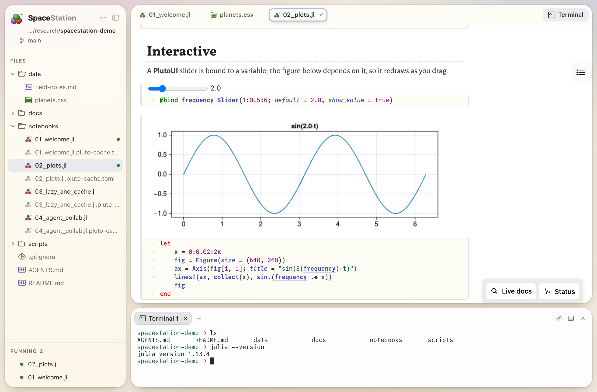
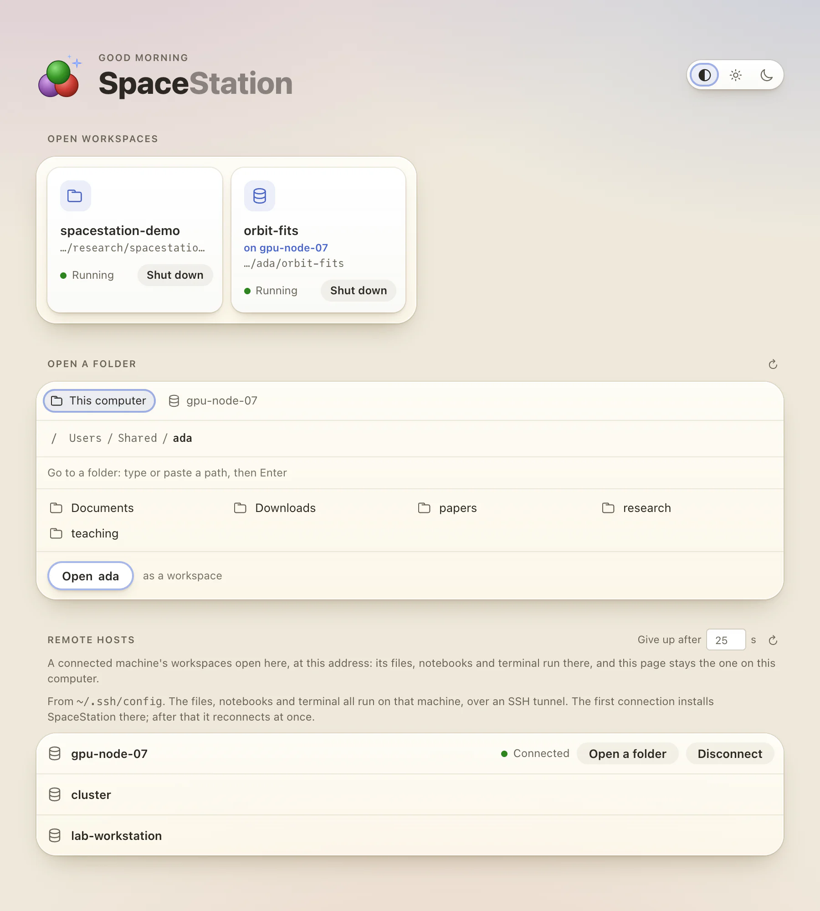
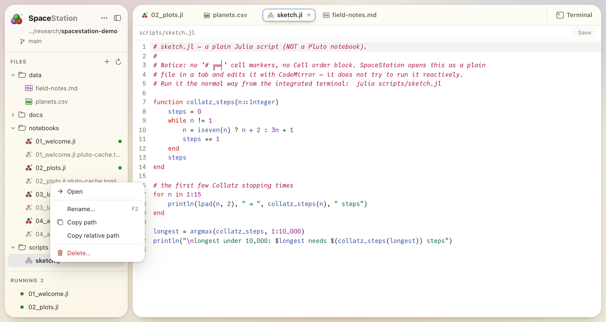
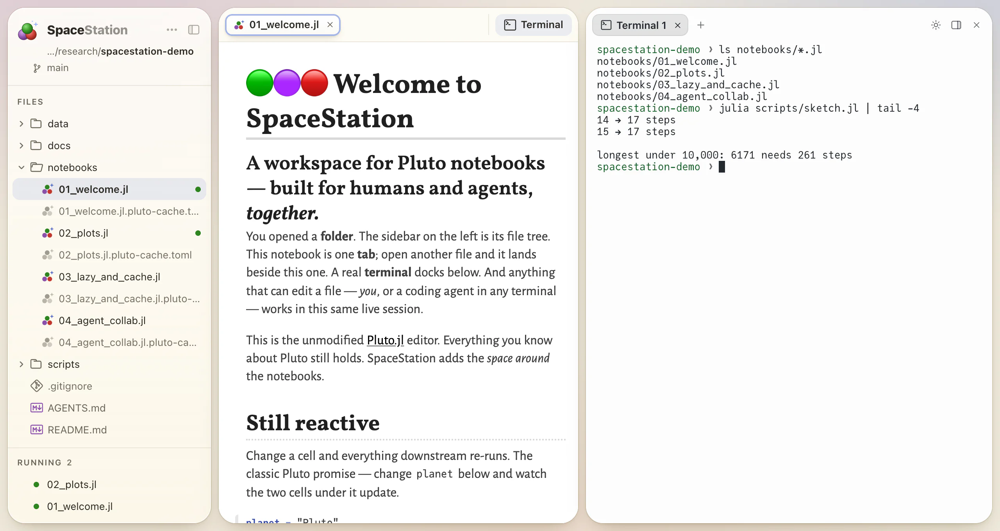
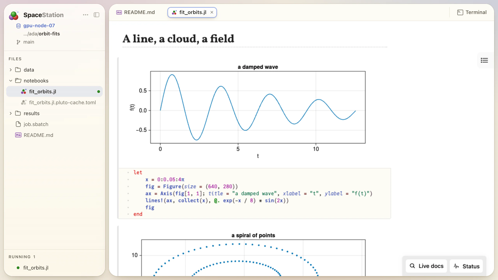
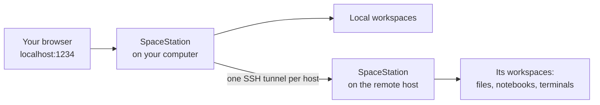
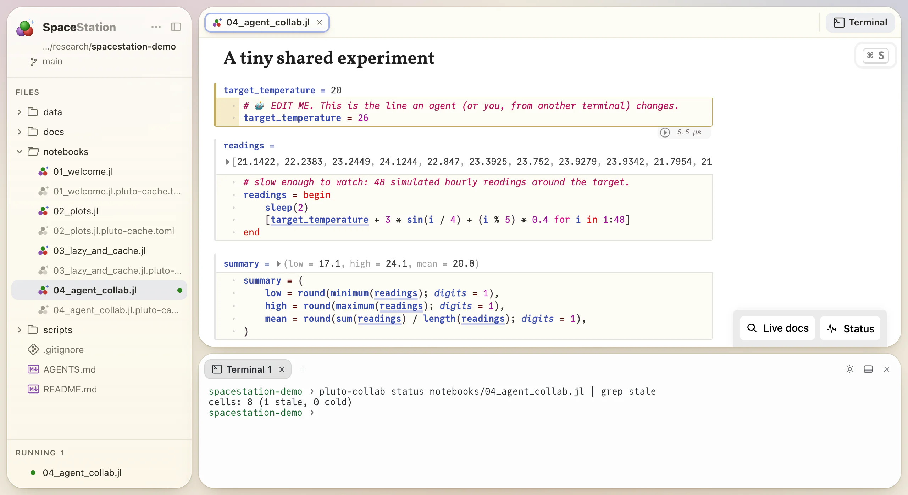
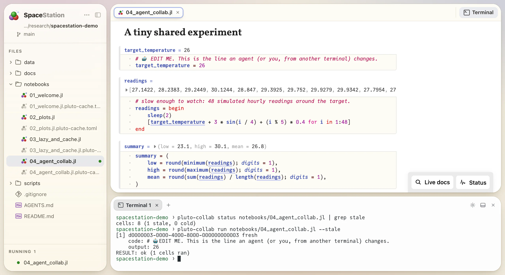
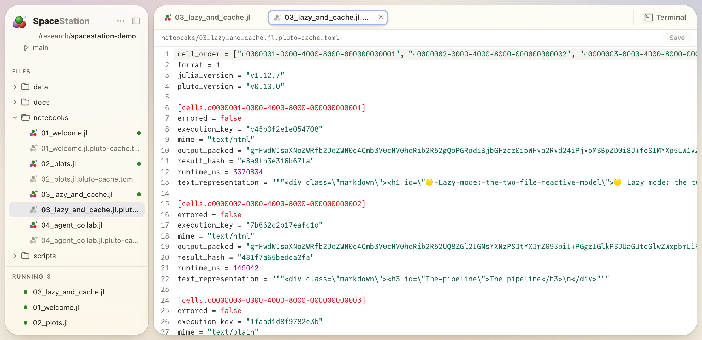

<div align="center">

<h1 align="center">

&nbsp;SpaceStation.jl
</h1>

### A workspace for Pluto notebooks, for people and coding agents.

[Pluto.jl](https://github.com/fonsp/Pluto.jl) gives you a reactive notebook.
**SpaceStation gives you the space around it:** folders as workspaces, notebooks and files in tabs,
a real terminal, workspaces on other machines over SSH, outputs that survive restarts, and a live
session that a coding agent can share with you. The notebook editor is Pluto's, unmodified.

<br>

<picture>
  <source media="(prefers-color-scheme: dark)" srcset="assets/screenshots/hero-dark.webp">
  
</picture>

</div>

## Get started

You need [Julia](https://julialang.org/install/) 1.12 or newer.

**1. Install it** (once):

```sh
julia -e 'import Pkg; Pkg.Apps.add("SpaceStation")'
```

This puts two commands in `~/.julia/bin`: `spacestation` and `pluto-collab`. If that folder is not
on your `PATH`, Julia says so and names the folder to add.

**2. Run it:**

```sh
spacestation
```

Your browser opens the launcher. Pick a folder and it opens as a workspace in a new tab. (If the
tab does not appear, allow pop-ups for `localhost`.)

**3. Update it** whenever you like:

```sh
julia -e 'import Pkg; Pkg.Apps.update("SpaceStation")'
```

| Command | What it does |
|---|---|
| `spacestation` | Open the launcher |
| `spacestation ~/project` | Open that folder as a workspace |
| `spacestation notebook.jl` | Open a single notebook |
| `spacestation --port 4000` | Use a port other than 1234 |
| `spacestation --no-browser` | Print the address instead of opening a browser |
| `spacestation --autorun` | Classic Pluto reactivity instead of [lazy mode](#you-and-an-agent-on-one-live-notebook) |
| `spacestation --help` | Everything else |

<details>
<summary>Other ways to install and run</summary>

<br>

- **From the Julia REPL, or on Julia 1.10 and 1.11** (which have no apps): `import Pkg; Pkg.add("SpaceStation")`, then
  `import SpaceStation; SpaceStation.run()`. Every `Pluto.run` keyword works.
- **The development version:** `Pkg.Apps.add(url="https://github.com/GroupTherapyOrg/SpaceStation.jl")`.
- **Remove it:** `Pkg.Apps.rm("SpaceStation")`.

</details>

> To try everything below on a ready-made folder, open the
> **[spacestation-demo](https://github.com/GroupTherapyOrg/spacestation-demo)** workspace.

---

## What you get

Everything here is something plain Pluto does not have. The notebook engine, the editor, reactivity,
`@bind`, package management and the `.jl` file format are all Pluto's, and notebooks stay
compatible in both directions.

| | |
|---|---|
| [One launcher for every workspace](#one-launcher-for-every-workspace) | [A folder is a workspace](#a-folder-is-a-workspace) |
| [A real terminal](#a-real-terminal) | [Workspaces on other machines](#workspaces-on-other-machines) |
| [You and an agent on one live notebook](#you-and-an-agent-on-one-live-notebook) | [Outputs that survive restarts](#outputs-that-survive-restarts) |

### One launcher for every workspace

The launcher is the page you start from and come back to. It shows the workspaces that are
running, lets you browse to a folder or paste a path, and lists the hosts in your `~/.ssh/config`.
Each workspace opens in its own browser tab, and the launcher stays where it is, so you can have
several open at once: on this computer and on others.

<div align="center">
<picture>
  <source media="(prefers-color-scheme: dark)" srcset="assets/screenshots/launcher-dark.webp">
  
</picture>
</div>

### A folder is a workspace

The folder's files are the sidebar. Notebooks open as tabs, each one the Pluto editor. Other files
open as tabs too, in a plain editor: Julia scripts, Markdown, CSV, TOML. From the tree you can add
files and folders, rename, delete and copy paths.

Closing a tab does not stop a notebook. It stays in the **Running** list until you stop it there.

<div align="center">
<picture>
  <source media="(prefers-color-scheme: dark)" srcset="assets/screenshots/files-dark.webp">
  
</picture>
</div>

### A real terminal

A shell on the machine the workspace runs on: your login shell on macOS and Linux, PowerShell on
Windows. Open as many as you need, and put them at the bottom, at the right, or in a tab.

Terminals belong to the server, not to the page. Reload the page or close the browser and they
keep running, with their scrollback, until you close them or stop SpaceStation.

Every terminal has `pluto-collab` on its `PATH` and knows which session it is in, so a coding
agent started there works on your live notebooks with no setup. A notebook's menu can also open a
terminal in that notebook's own package environment.

<div align="center">
<picture>
  <source media="(prefers-color-scheme: dark)" srcset="assets/screenshots/terminal-dark.webp">
  
</picture>
</div>

### Workspaces on other machines

Click a host from your `~/.ssh/config`. SpaceStation connects, installs itself there the first
time, and from then on that machine's folders open like local ones: in the same launcher, at the
same address on your computer, next to your local workspaces. The files, the notebook processes
and the terminals are all on the remote machine.

<div align="center">
<picture>
  <source media="(prefers-color-scheme: dark)" srcset="assets/screenshots/remote-dark.webp">
  
</picture>
</div>



What it needs:

- **SSH keys.** `ssh <host>` must work without asking for a password. Hosts behind a `ProxyJump`
  are fine.
- **Julia on the remote host.** [juliaup](https://github.com/JuliaLang/juliaup) is the easy way.

There are no ports to forward by hand. The tunnel is opened for you and reopened if the connection
drops. What runs on the remote host keeps running when your laptop sleeps or disconnects, and it
is there when you connect again.

### You and an agent on one live notebook

SpaceStation's default is **lazy mode**: editing a cell, in the browser or in the file on disk,
marks it **stale** instead of running it. That is what lets a person in the browser and a coding
agent in a terminal work on the same running notebook.

**1. An edit is staged.** The agent changes the `.jl` file with its ordinary file tools. Within a
second the cell turns amber in your browser, still showing its old output. Nothing has run.

<div align="center">
<picture>
  <source media="(prefers-color-scheme: dark)" srcset="assets/screenshots/lazy-stale-dark.webp">
  
</picture>
</div>

**2. A run applies it.** `run --stale` runs the stale cells, and what depends on them follows
through Pluto's reactivity. You watch it happen in the browser.

<div align="center">
<picture>
  <source media="(prefers-color-scheme: dark)" srcset="assets/screenshots/lazy-ran-dark.webp">
  
</picture>
</div>

The whole agent side is one small command, with no MCP server and no plugin:

```sh
pluto-collab status nb.jl               # each cell: stale, cold, errored, or its output
pluto-collab run    nb.jl --stale       # run what is out of date; exit code 1 if a cell errors
pluto-collab output nb.jl --cell <id>   # one cell's full output
pluto-collab figure nb.jl --cell <id>   # save one cell's plot as an image
```

`pluto-collab` is a shell script (bash and curl). On Windows, or anywhere those are missing,
`spacestation collab …` is the same set of commands built into the app.

**[COLLAB.md](COLLAB.md)** has the details, the HTTP API underneath, and a block to paste into a
repository's `AGENTS.md`.

### Outputs that survive restarts

Every notebook is two files: the `.jl`, which is your code and is exactly what Pluto writes, and a
`<notebook>.jl.pluto-cache.toml` beside it that holds each cell's output. Open a notebook after a
restart and its outputs are back at once, without running anything. Plain Pluto runs the whole
notebook again.

A stored output is only used while the cell's code, and the results it depends on, are unchanged.
Cells that should never be reused (random numbers, the clock, files) opt out with
`always_stale = true`. The cache is plain TOML that any tool can read, and it is safe to delete.

<div align="center">
<picture>
  <source media="(prefers-color-scheme: dark)" srcset="assets/screenshots/sidecar-dark.webp">
  
</picture>
</div>

---

## Where it runs

- **Systems:** macOS, Linux and Windows. A browser walkthrough of the app runs on all three in CI.
- **Browsers:** Chrome and other Chromium browsers, and Firefox. Safari has not been checked with
  a workspace on a remote host.
- **Light and dark:** follows your system, or pick one in the launcher.

## Relationship to Pluto.jl

SpaceStation is a friendly fork of [Pluto.jl](https://github.com/fonsp/Pluto.jl). The notebook engine,
editor, file format and reactivity are Pluto's, and notebooks remain fully compatible in both
directions. For everything about notebooks themselves (reactivity, `@bind`, packages, exporting),
see the [Pluto documentation](https://plutojl.org/). 🎈

SpaceStation adds the space around the notebooks: workspaces, tabs, terminals, remote hosts,
stored outputs, and working alongside an agent. `--autorun` gives you classic Pluto reactivity
whenever you want it.

**SpaceStation is developed and owned by Dale Black / [GroupTherapyOrg](https://github.com/GroupTherapyOrg).
It is an independent fork and is NOT developed, maintained, or endorsed by the Pluto.jl team.** Please
direct SpaceStation questions, issues, and feedback to this repository, not to the Pluto developers.

## Status

⚠️ **Early and experimental.** SpaceStation is under active development by a small team; expect rough
edges and breaking changes. Issues and ideas are welcome on this repo.

## AI disclosure

Much of SpaceStation's code is written with AI assistance (Claude). Commits are co-authored accordingly.

## License

MIT — see [LICENSE](LICENSE). SpaceStation is developed and owned by Dale Black / GroupTherapyOrg.
It builds on **Pluto.jl** (© the Pluto.jl authors — Fons van der Plas and contributors, MIT), which
retains its own copyright; the original Pluto license is preserved in [LICENSE](LICENSE).
